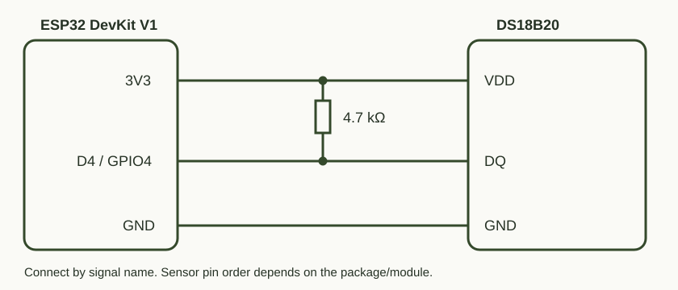

# DS18B20Test — проверить датчик до сборки большого проекта

## Зачем это нужно

Проверяет, правильно ли подключён DS18B20 и можно ли получить настоящее измерение. Если термометр на сайте показывает ошибку, этим скетчем удобно проверить сам датчик отдельно от браузера, Wi-Fi и MQTT.

## Чему учит

Обмен по OneWire, адресация датчиков, проверка CRC и ожидание завершения преобразования температуры. Скетч показывает число устройств, ROM-адрес, результат CRC, температуру и разрядность. Значение ошибки не выдаётся за измерение.

## Схема подключения



| ESP32 | DS18B20 / элемент |
|---|---|
| 3V3 | VDD датчика и один вывод резистора 4,7 кОм |
| D4 / GPIO4 | DQ датчика и второй вывод резистора |
| GND | GND датчика |

Резистор стоит **между DQ и 3,3 В**, а не последовательно с DQ. Это схема с отдельным питанием, не паразитное питание. Контакты на схеме обозначены по сигналам: порядок ножек проверяй по документации своего корпуса; цвета проводов модулей могут отличаться. Переставляй провода при отключённом питании.

## Запуск

Установи OneWire 2.3.8 и DallasTemperature 4.0.6 по [корневой инструкции](../README.md), затем:

```powershell
python tools/board.py flash temperature
python tools/board.py monitor
```

Ожидай `devices=1`, `ROM_CRC=OK` и `temperature_C=...`. Аккуратно согрей корпус датчика пальцами: показания должны постепенно измениться. `NO SENSOR` означает, что нужно проверить питание, DQ, подтяжку и соединения макетки.

## Результат

2026-11-07 на реальном датчике найдена одна DS18B20, ROM CRC корректен, получены показания около 24 °C. Это проверка работоспособности, не калибровка точности по эталонному термометру.
