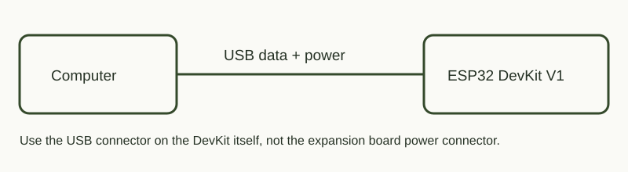

# SerialTest — проверить, что плата жива

## Зачем это нужно

Первый диагностический проект: проверяет USB-кабель, порт, прошивку и обмен с компьютером. Когда сложный проект не работает, этот скетч помогает отделить проблему подключения от ошибки датчика или Wi-Fi.

## Чему учит

`setup()` запускается при старте, `loop()` повторяется. `millis()` позволяет выводить сообщение раз в секунду без длинной блокирующей паузы. Serial показывает время работы, счётчик сообщений и свободную память.

## Подключение



Внешних деталей нет. Нужен USB-кабель с передачей данных. При использовании расширителя подключай кабель к разъёму **самой DevKit**, а не к входу питания расширителя.

## Запуск

Из корня репозитория после [подготовки](../README.md):

```powershell
python tools/board.py flash serial
python tools/board.py monitor
```

Ожидай строку `ESP32 serial test started`, затем примерно раз в секунду `ESP32 OK | count=...`. Скорость 115200 бод. Растущий счётчик означает, что программа продолжает работать.

## Результат

Проверен на физической плате. Этот проект проверяет программный запуск и Serial, но не доказывает исправность всех GPIO или внешней схемы.
