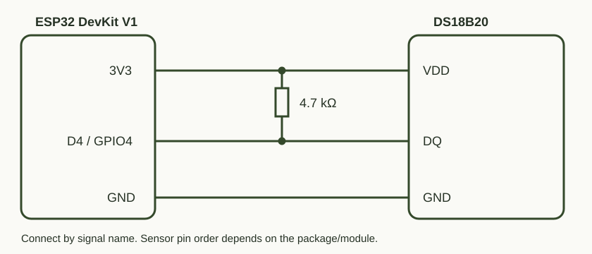
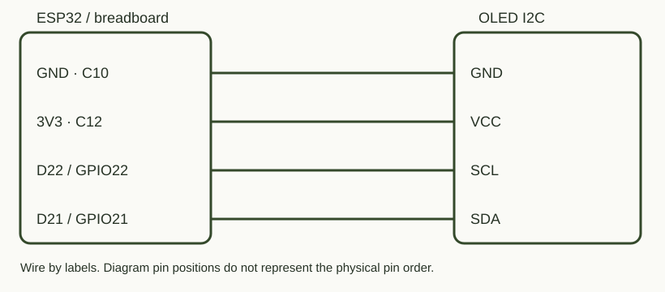
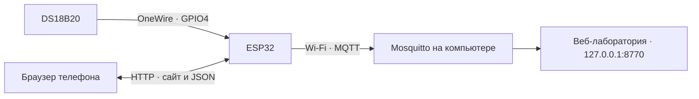

# ТЕРМО — датчик, сайт и автоматическая телеметрия

## Зачем это нужно

Превращает ESP32 в самостоятельный сетевой термометр. Можно увидеть температуру с телефона, проследить нагрев и остывание на графике, скачать данные или передавать их на компьютер без открытой вкладки браузера. Это основа для комнатного мониторинга и будущих автоматизаций.

## Что делает и чему учит

DS18B20 измеряется примерно раз в 2 секунды без блокирующего ожидания преобразования. Локальный сайт показывает текущее значение, минимум, максимум, среднее и 300 последних измерений — около 10 минут. Есть график, CSV, управление LED и Wi-Fi сканер. После перезапуска история очищается.

Проект объединяет датчик, HTTP/JSON, браузерный интерфейс, хранение настроек в NVS и MQTT. Плата одновременно создаёт свою точку доступа и подключается к домашней сети.

## Схема подключения



| ESP32 | Подключить |
|---|---|
| 3V3 | VDD датчика и один вывод резистора 4,7 кОм |
| D4 / GPIO4 | DQ датчика и второй вывод резистора |
| GND | GND датчика |
| GPIO2 | Используется встроенный LED; внешний провод не нужен |

Резистор соединяет DQ с 3,3 В. Это не последовательный резистор и не подтяжка к 5 В. Порядок ножек датчика проверь по его документации. Собирай при отключённом питании. Для прошивки подключай USB к самой DevKit.

## Как данные попадают на экран

### Дополнительный OLED I²C — подключение и первичная проверка



OLED GND → общая земля (C10 в текущей макетке), VCC → 3V3 (C12), SCL → D22/GPIO22, SDA → D21/GPIO21. При установке экрана в макетку каждая ножка должна попасть в отдельный нумерованный ряд. Порядок ножек определяй по маркировке экрана; расположение на схеме условное. DS18B20 остаётся на D4, его подтяжка 4,7 кОм сохраняется.

Прошивка сканирует I²C при запуске. Ответ доступен в Serial (`I2C FOUND`) и по `/api/i2c`. На физической плате подтверждены адрес 0x3C и отсутствие ошибок шины.

Добавлен вывод через Adafruit SSD1306 для предполагаемого экрана 128×64: крупная температура с одной цифрой после точки, L/H (минимум/максимум с запуска), мини-график последних 128 измерений (до 4 минут 16 секунд). Вертикальная шкала графика автоматическая. W+/W− — домашний Wi-Fi, M+/M− — MQTT. Обновление экрана раз в секунду; датчик измеряется раз в 2 секунды. При ошибке датчика выводится NO SENSOR, при запуске WAIT. Подписи ASCII, без кириллицы.

Адрес 0x3C сам по себе не определяет контроллер. Инициализация драйвера и отправка кадра ещё не доказывают правильность картинки: нужно визуальное подтверждение. Если экран пустой или изображение искажено, проверь модель модуля: возможен другой контроллер, например SH1106. Отсутствующий OLED не останавливает сайт и датчик.

Дополнительные библиотеки: Adafruit SSD1306 2.5.17, Adafruit GFX Library 1.13.0, Adafruit BusIO 1.17.4. Установка: `arduino-cli lib install "Adafruit SSD1306@2.5.17"` (зависимости устанавливаются автоматически).

### Текущий вид: Неон

После подтверждения правильной работы OLED добавлен [анимированный Неон](assets/neon/README.md). Слева — шесть однобитных кадров кота 64×64, справа — температура, W/M и мини-график последних 60 измерений (около 2 минут). Кадр обновляется каждые 180 мс; частота измерения температуры остаётся раз в 2 секунды. L/H доступны на сайте, в этом компактном виде OLED они уступили место персонажу. При отключении датчика рядом с Неоном выводится NO SENSOR. Подключение не меняется.



## Запуск

Из корня репозитория подготовь библиотеки, конфигурацию платы и брокер по [основной инструкции](../README.md). Брокер в LAN-режиме генерирует приватный `mqtt_private.h`, без которого эта версия прошивки не собирается.

```powershell
python tools/board.py build dashboard
python tools/board.py flash dashboard
python tools/board.py monitor
```

На телефоне подключись к **ESP32-DevKit**, пароль **esp32test**. Термометр: **http://192.168.4.1**. Для MQTT открой **http://192.168.4.1/setup**, введи домашний Wi-Fi 2,4 ГГц и IPv4 компьютера с брокером. Эти настройки сохраняются на плате. Домашний роутер выдаст плате IP, по которому сайт будет доступен в общей сети.

## Автоматическая передача

Тема: `lab/esp32/temperature`. Каждое сообщение содержит `demo:false`, `valid`, `temperature`, `unit`, `sequence`, `uptime_ms`, `sample_age_ms`. Публикация использует QoS 0 и Retain: получатель узнаёт последнее значение, но полная история на брокере не накапливается. При недоступности датчика отправляется `valid:false` и `temperature:null`.

В `lab/esp32/status` публикуется online; Last Will сообщает offline после обнаружения неожиданного обрыва. Есть повторные подключения Wi-Fi и MQTT. Потерянные за время отключения измерения не догоняются. Компьютер с брокером должен оставаться включённым.

## Файлы и проверка

- `ui.html` — исходный интерфейс без CDN и внешних шрифтов.
- `mqtt_setup.h` — форма настройки домашней сети.
- `dashboard_page.h` — сжатая страница, генерируется сборщиком и не коммитится.
- `mqtt_private.h` — локальные реквизиты устройства, не коммитятся.
- `python tools/check_dashboard.py` — проверка браузерного интерфейса в Edge с помеченными демонстрационными данными; они не попадают в прошивку.

Проверено 2026-11-07: датчик, прошивка, AP, HTTP-запросы из домашней сети и настоящие MQTT-показания каждые 2 секунды. В браузере проверены график, управление, сканер, состояние ошибки и безопасный вывод SSID. Контролируемый тест восстановления после отдельного разрыва Wi-Fi пока не выполнен.
