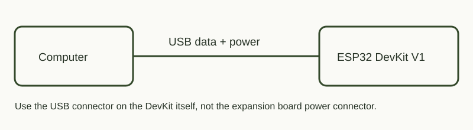

# WiFiLed — управление светом из браузера

## Зачем это нужно

Позволяет управлять ESP32 с телефона без отдельного приложения и домашнего роутера. Это основа для локальной панели управления: сначала встроенный светодиод, позже другие исполнительные устройства с подходящей силовой схемой.

## Что делает и чему учит

- Создаёт свою Wi-Fi сеть и HTTP-сервер.
- Позволяет включить LED, менять яркость и включать плавное «дыхание».
- Использует PWM и гамма-коррекцию для воспринимаемой яркости.
- Асинхронно сканирует сети 2,4 ГГц, сохраняя работу сервера.

## Подключение



Используется **встроенный LED на GPIO2** нашей DevKit. Внешний LED и резистор для этого скетча не нужны. На другой модели платы встроенный светодиод может находиться на другом GPIO или иметь другую полярность.


## Запуск

Из корня репозитория:

```powershell
python tools/board.py flash wifi
```

Подключись к **ESP32-DevKit**, пароль **esp32test**, открой **http://192.168.4.1**. При предупреждении «без интернета» оставайся в этой сети. Попробуй яркость, дыхание и поиск сетей.

## Результат и ограничения

Управление яркостью, дыхание и сканер проверены на плате. Сканер показывает сведения о видимых точках доступа, не подключается к ним и не расшифровывает трафик. GPIO2 в этом проекте не предназначен для прямого подключения ленты или другого мощного потребителя.
