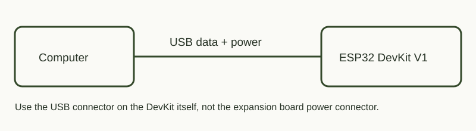
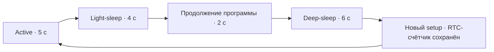

# Эксперимент с режимами сна ESP32

## Зачем это нужно

Понять, как сделать устройство, которое редко измеряет температуру и долго работает от батареи. Сначала нужно проверить, что программа засыпает, просыпается и правильно сохраняет состояние, а затем измерять потребление. Этот проект проверяет именно программную часть; готовый сетевой термометр со сном пока не объединён.

## Схема подключения для выполненного опыта



Внешние GPIO не подключаются. Питание и Serial идут по USB, встроенный GPIO2 выключен. DS18B20 этому скетчу не нужен: измерения датчика здесь не выполняются. Таймер RTC находится внутри ESP32.



## Запуск

Из корня репозитория:

```powershell
python tools/board.py flash sleep
python tools/board.py monitor
```

Ожидай `LIGHT EXIT`, затем `DEEP ENTER`, новый `BOOT` с причиной `TIMER` и увеличившийся RTC-счётчик. Сеть ESP32-DevKit во время этого скетча не создаётся. После опыта можно вернуть текущую панель: `python tools/board.py flash dashboard`.

## Что меняется

| Режим | Поведение программы | Применение |
|---|---|---|
| Active | Программа исполняется | Веб-панель, обработка событий |
| Light-sleep | Состояние обычной RAM сохраняется; исполнение продолжается после вызова сна | Короткая пауза с сохранением состояния |
| Deep-sleep | CPU и большая часть RAM отключены; пробуждение запускает программу заново | Долгая пауза между редкими измерениями |

Таймер RTC может пробуждать оба режима. Для внешнего пробуждения из Deep-sleep на классической ESP32 используются RTC GPIO через EXT0/EXT1; есть также touch и ULP. Внешние подключения сейчас не делаем.

Обычные Wi-Fi/Bluetooth-соединения во время этих режимов сна не сохраняются. Наша работающая веб-панель поэтому не может постоянно обслуживать телефон в Deep-sleep.

Источник: [Espressif, Sleep Modes для ESP32](https://docs.espressif.com/projects/esp-idf/en/latest/esp32/api-reference/system/sleep_modes.html).

## Выбор для будущего автономного термометра

Для будущего автономного термометра подходит **Deep-sleep с таймером**: проснуться, получить показания датчика, при необходимости передать их, снова заснуть. Датчик уже есть и проверен в отдельных проектах, но в этот эксперимент чтение температуры и передача ещё не включены. Период измерений нужно выбирать под требования устройства.

Если нужна постоянно доступная веб-страница, оставляем Active либо отдельно проектируем управление энергосбережением радиосвязи. Light-sleep полезен, когда важнее продолжить программу с прежним состоянием.

## Что проверяет SleepLab

1. Пять секунд обычной работы, радио и управляемый светодиод выключены.
2. В обычную переменную записывается `42`.
3. Light-sleep на четыре секунды. После возврата выводятся причина пробуждения, длительность и сохранившееся значение.
4. Две секунды работы.
5. Deep-sleep на шесть секунд.
6. Новый `setup()`: обычная переменная снова равна `0`, счётчик в `RTC_DATA_ATTR` увеличивается.

Функциональное пробуждение не доказывает конкретное потребление тока.

Пример таймерного пробуждения: [Arduino-ESP32, Timer Wake Up](https://docs.espressif.com/projects/arduino-esp32/en/latest/api/deepsleep.html#timer-wake-up).

## Измерения — следующий, ещё не выполненный этап

Мультиметр уже есть, но модель, входы и диапазоны ещё не проверены. Выполненный опыт не требует включения мультиметра. Конкретная схема измерения тока будет добавлена после проверки прибора и способа питания; не переключай подключённый параллельно питанию прибор в режим измерения тока.

Для DevKit и расширителя измеряется вся выбранная сборка: стабилизаторы, USB-UART и индикаторы тоже могут потреблять ток. Ток чипа из datasheet нельзя выдавать за ток этой платы.

Нужно зафиксировать питание, наличие расширителя, режим радио и светодиодов, прибор, его диапазон и точку измерения. При замере тока прибор включают **последовательно**, а не параллельно источнику питания. Конкретную схему подключения выберем по модели купленного прибора.

| Конфигурация | Active, мА | Light-sleep, мА | Deep-sleep, мА |
|---|---|---|---|
| DevKit, без радио, LED выключен | не измерено | не измерено | не измерено |
| DevKit + расширитель | не измерено | не измерено | не измерено |

`battery_estimate.py` считает оценку после ввода реальных токов, длительностей фаз и ёмкости батареи. Все токи должны относиться к одной точке питания и напряжению. Численную автономность пока не рассчитываем.
