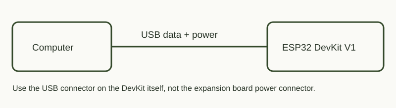

# SleepLab — скетч проверки сна

## Зачем это нужно

Проверить таймерное пробуждение и отличие обычной RAM от RTC-памяти перед созданием автономного датчика. Light-sleep продолжает текущую программу, Deep-sleep запускает `setup()` заново.

## Подключение

Внешняя обвязка не требуется. Радио и встроенный LED GPIO2 выключены. Подключение мультиметра не входит в уже выполненный опыт.

## Запуск и результат

Из корня репозитория: `python tools/board.py flash sleep`, затем `python tools/board.py monitor`.

Проверены Light-sleep на 4 секунды, Deep-sleep на 6 секунд, возврат из Light-sleep с обычной переменной 42 и рост RTC-счётчика после Deep-sleep. Ток и автономность не измерялись.

Подробности, схема последовательности и дальнейший план: [описание эксперимента](../README.md). Фактические результаты: [RESULTS.md](../RESULTS.md).
