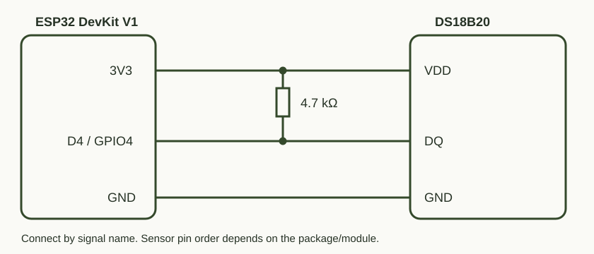
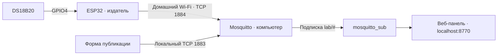

# MQTT-лаборатория — сообщения между устройствами

## Зачем это нужно

Позволяет получать температуру ESP32 на компьютере, когда сайт платы закрыт. Один датчик публикует данные, несколько программ могут получать их независимо. Позже подписчиками могут стать система истории, Home Assistant или автоматизация; сейчас реализованы брокер и наглядная веб-лаборатория.

## Схема подключения и обмена

Физическое подключение датчика такое же, как в термометре:



DQ → D4/GPIO4, VDD → 3V3, GND → GND, резистор 4,7 кОм между DQ и 3V3. USB питает плату; **передача MQTT идёт по домашнему Wi-Fi**, а не по USB.



ESP32 и компьютер должны быть в одной доступной друг для друга сети. Локальная веб-панель открыта только на компьютере. Для входящего MQTT устройства используется отдельный пароль и ACL на публикацию `lab/esp32/#`.

## Что здесь важно понять

- **Брокер** маршрутизирует сообщения, но ничего не измеряет и не исполняет сам.
- **Тема** — адрес: `lab/esp32/temperature`. Регистр имеет значение.
- **Payload** — текст или JSON, смысл которого определяют отправитель и получатель.
- Подписка `lab/#` получает все уровни внутри lab; `lab/+/temperature` допускает ровно один промежуточный уровень.
- **Retain** сохраняет последнее сообщение темы для позднего подписчика. Это не история. Пустая retained-публикация удаляет сохранённое значение; обычная публикация без Retain его не удаляет.
- **QoS 0** — без MQTT-подтверждения; используется для регулярной температуры. **QoS 1** допускает повторы; используется ручной формой. Подтверждение брокера не доказывает выполнение физического действия.
- **Last Will** сообщает об обнаруженном неожиданном отключении устройства, а не мгновенно при каждом обрыве.

## Запуск на Windows

Из корня репозитория:

```powershell
powershell -ExecutionPolicy Bypass -File mqtt/install-mosquitto.ps1
python mqtt/lab.py --lan-ip 192.168.1.110
```

Адрес выше — **пример**: подставь свой IPv4 из `ipconfig`. Mosquitto 2.1.2 распаковывается из официального дистрибутива, системная служба не устанавливается. Нужны Python 3 и 7-Zip. Реквизиты устройства и заголовок прошивки генерируются локально.

Для ESP32 разреши TCP 1884 из локальной подсети в PowerShell от администратора:

```powershell
powershell -ExecutionPolicy Bypass -File mqtt/allow-device.ps1 -BrokerIP 192.168.1.110
```

Скрипт сохраняет и отключает конфликтующие входящие запреты только для нашего Mosquitto. Остальные правила Windows не меняет. ID отключённых правил остаются в локальном `firewall-disabled-blocks.json` для восстановления. При смене IP компьютера нужно обновить настройки брокера, платы и правило.

Затем прошей `dashboard` и настрой Wi-Fi через `/setup` по [инструкции термометра](../ThermoDashboard/README.md). Открой **http://127.0.0.1:8770**. Настоящие сообщения имеют `demo:false`; ручной тест температуры использует `demo:true`. Плата не подписана на команды управления LED — отправка текста ON сама по себе светодиод не включает.

Для первого опыта без платы можно запустить `python mqtt/lab.py` без LAN-порта и пользоваться ручной формой. Не запускай второй экземпляр поверх работающего. Ctrl+C в терминале останавливает лабораторию и её дочерние процессы.

## Хранение и свежесть

В памяти лаборатории остаются последние 150 сообщений. Брокер запущен с persistence=false: его перезапуск очищает retained и сессии. Температура скрывается, если 8 секунд не приходит новое сообщение. Закрытие вкладки не останавливает брокер; выключение компьютера останавливает обмен.

## Проверки и результаты

Когда лаборатория остановлена: `python mqtt/lab.py --check` проверяет реальные pub/sub, wildcard и retained-доставку позднему подписчику. При работающем LAN-режиме: `python mqtt/check_lan.py` проверяет отказ анонимному клиенту и доставку авторизованной публикации, помеченной DEMO.

Проверено 2026-11-07: полный путь DS18B20 → ESP32 → домашний Wi-Fi → Mosquitto → веб-панель, последовательные настоящие измерения каждые 2 секунды. Найден и исправлен конфликт запрещающих правил Windows Firewall. Отдельный контролируемый тест восстановления после разрыва Wi-Fi ещё не выполнен.

Официальная документация: [Mosquitto](https://mosquitto.org/download/), [конфигурация](https://mosquitto.org/man/mosquitto-conf-5.html), [подписчик](https://mosquitto.org/man/mosquitto_sub-1.html).
